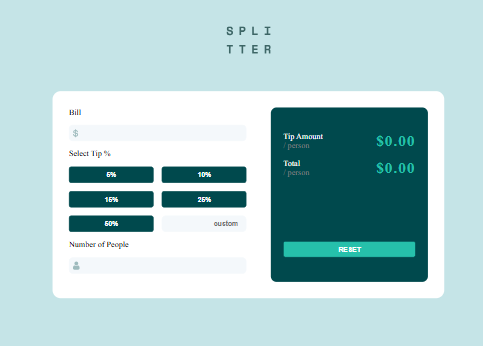

# Frontend Mentor - Tip calculator app solution

This is a solution to the [Tip calculator app challenge on Frontend Mentor](https://www.frontendmentor.io/challenges/tip-calculator-app-ugJNGbJUX). Frontend Mentor challenges help you improve your coding skills by building realistic projects.

## Table of contents

- [Overview](#overview)
  - [The challenge](#the-challenge)
  - [Screenshot](#screenshot)
- [My process](#my-process)
  - [Built with](#built-with)
  - [What I learned](#what-i-learned)
  - [Continued development](#continued-development)
  - [AI Collaboration](#ai-collaboration)

## Overview

### The challenge

Users should be able to:

- View the optimal layout for the app depending on their device's screen size
- See hover states for all interactive elements on the page
- Calculate the correct tip and total cost of the bill per person

### Screenshot

### Links

- Solution URL: [For tip calculator](https://github.com/abdiabduljebar16-ship-it/tip-calculator-app)
- Live Site URL: [For tip calculator](https://abdiabduljebar16-ship-it.github.io/tip-calculator-app/)

## My process

### Built with

- Semantic HTML5 markup
- CSS custom properties
- Flexbox
- CSS Grid
- Mobile-first workflow
- vanila javascript

### What I learned

From this Tip Calculator project, i learned how to build an interactive frontend using HTML, CSS, and JavaScript: handling user inputs, responding to button clicks, performing calculations, updating the DOM dynamically, validating inputs, creating responsive layouts for desktop/mobile, and adding hover/focus states.

### Continued development

i will continue to build projects related to javascript to strength my knowledge.

### AI Collaboration

i used AI to give me clues on how to do specific tasks.
